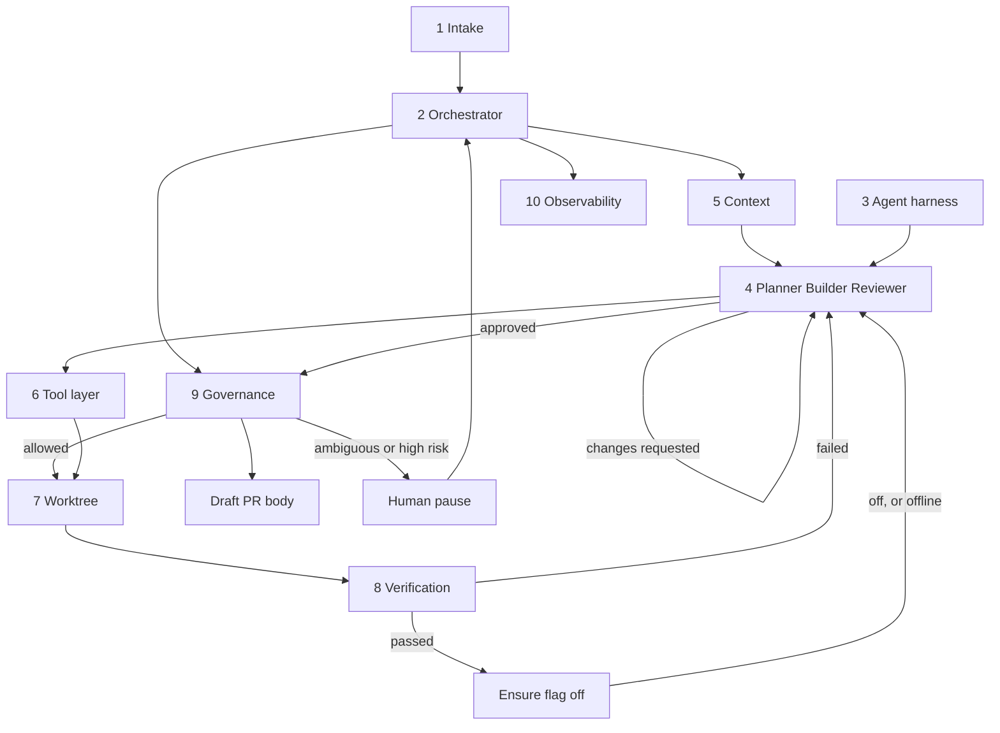
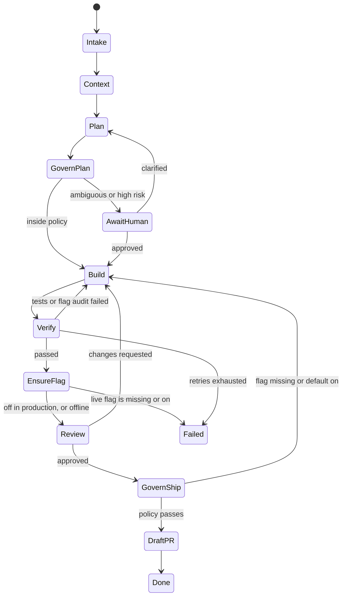

# Decora software factory

A feature request goes in, a draft pull request comes out, or the job pauses when a human has to decide.

The factory builds changes for Decora. The default demo uses a disposable Decora-shaped fixture in `.factory/demo-target`, without accessing any external checkout. It does not furnish rooms. It does not merge. It analyzes the repo, plans the change, implements it in an isolated git worktree, runs a deterministic gate, reviews the diff it actually produced, and writes a draft pull request for a person.

`make demo` uses the OpenAI Agents SDK with `gpt-4.1` (override with `FACTORY_OPENAI_MODEL`). `OPENAI_API_KEY` is read from the environment or from this repo's gitignored `.env`. The factory prints where the key came from, not the key. `--agents mock` runs the scripted specialists instead.

```bash
make demo
```

## Architecture



The stage machine is a graph. Verification and review both send work back to the builder. Ambiguity stops for a human instead of guessing.



| # | Component | Where | What it does |
| --- | --- | --- | --- |
| 1 | Intake | `factory/intake/` | JSON spec or a GitHub issue body |
| 2 | Orchestrator | `factory/orchestrator/` | Python state machine, SQLite job state, retries, timeouts |
| 3 | Agent harness | `factory/harness/` | Mock offline, or OpenAI Agents SDK structured outputs |
| 4 | Specialist agents | `factory/agents/` | Planner, Builder, Reviewer |
| 5 | Context | `factory/context/` | Read-only repo scan. Skips `app/pim/` |
| 6 | Tool layer | `factory/tools/` | Allowlisted commands and path-checked edits |
| 7 | Execution | `factory/execution/` | Git worktree outside the primary checkout |
| 8 | Verification | `factory/verification/` | pytest, ruff, mypy, syntax compile, flag audit |
| 9 | Governance | `factory/governance/`, `policy.yaml` | Permissions and human-approval pauses |
| 10 | Observability | `factory/observability/` | JSON logs, OpenTelemetry-ready spans, run summary |

Agents return structured data. The orchestrator decides the next stage. The tool layer is what actually writes files and runs commands. The Temporal workflow now calls the same stage handlers as activities. The local runner remains available for short synchronous demos.

## Demo

From this directory:

```bash
make demo
```

That command:

1. Loads `samples/decor-room-mood.json`.
2. Creates a git worktree of the local demo fixture. Its flag evaluator is a stub returning the supplied default; generated tests exercise on/off behavior.
3. Plans a dark capability: `GET /api/capabilities` gains `room_mood` only when LaunchDarkly flag `decor-room-mood` is on. The code default is off.
4. The OpenAI builder is told to ship `FLAG_DEFAULT = False`. If pytest or the flag audit fails, that log goes back to the builder. `--agents mock` still ships the default on once, then repairs it, so the retry is visible without an API call.
5. After verification passes, the factory creates or reuses LaunchDarkly flag `decor-room-mood` and checks that production is off before the reviewer runs. `make demo` does this when `LAUNCHDARKLY_API_TOKEN` resolves. `make demo-offline` skips the live check.
6. The reviewer reads `git diff`, the verification log, and the acceptance lines. It does not trust the builder's summary.
7. Writes a draft pull request body under `.factory/runs/<job-id>/` and deletes the worktree and the `factory/job-*` branch. The body includes the LaunchDarkly URL when the live check ran.

Nothing is pushed. `policy.yaml` has `pull_request.allow_push: false`. Publishing requires both an explicit `--push` and a policy that permits it. `policy.decora.yaml` opts into draft PRs for the real target.

Other entry points:

```bash
make test
make demo-mock
python -m factory demo --agents mock --ld offline --repo /path/to/decor-agent
python -m factory run samples/decor-room-mood.json --repo /path/to/decor-agent
python -m factory run samples/ambiguous.json --repo /path/to/decor-agent
python -m factory resume <job-id> --answer "flag decor-room-mood on capabilities, default off"
python -m factory status <job-id>
python -m factory issue --slug owner/name --number 12
```

`samples/ambiguous.json` stops before any code is written and asks for acceptance checks and a flag key.

Artifacts for a run:

- `implementation_plan.json`
- `review_report.json`
- `verify-1.diff` (the failing build) and `diff.patch` (what would ship)
- `pr-body.md`
- `summary.json` with duration, token counts, and retries
- `log.jsonl` and `trace.jsonl`

## LaunchDarkly

Feature flags and guarded rollout are deferred (`flags.enabled: false`). The factory does not require new flags, audit flag declarations, or provision LaunchDarkly, even if an older issue has a flag key. Tests, review, risk approval and migration safety remain required. Existing application flags are preserved.

When a token is available, passing verification is not enough to reach the reviewer. The factory calls the LaunchDarkly REST API and:

- creates boolean flag `decor-room-mood` in project `decor-agent-demo-v2` if it does not exist
- reuses it if it does
- keeps targeting off, serving the false variation, in `test` and `production`
- tags it `software-factory` and `job-<id>`
- writes a description that points at `.factory/runs/<job-id>`
- puts `https://app.launchdarkly.com/projects/decor-agent-demo-v2/flags/<key>/targeting?env=production` in the pull request body

The reviewer does not run unless that production check passes. Turning the flag on stays a human action.

Set the token in the environment, or in this factory repo’s gitignored `.env`. The factory reads `LAUNCHDARKLY_API_TOKEN` and does not print it.

```bash
export LAUNCHDARKLY_API_TOKEN="..."   # preferred; do not commit this
make demo                              # auto: live when the token resolves
make demo-offline                      # skip LaunchDarkly
python -m factory demo --repo /path/to/decor-agent --ld live
```

`auto` also reads `LAUNCHDARKLY_API_TOKEN` from this factory repo’s `.env` when the environment variable is unset. `--ld live` fails the job if the token is missing or production is not off. `--ld offline` still runs the demo and says the live check was skipped.

## Policy

`policy.yaml` is the approval boundary:

- Allowlisted commands: pytest, ruff, mypy, python, git status/diff/add/commit/log/show/rev-parse
- Denied: push, reset, rebase, `--no-verify`, secret paths, `app/pim/**`
- Auto-approve only `low` risk plans
- Pause on an ambiguous plan or a `high` risk plan
- Pull requests stay drafts

The execution environment may create and delete `factory/job-*` worktrees. The agent tool layer cannot.

## Tests

```bash
make test
```

Orchestrator tests cover the verify loop, exhausted retries, human pause and resume, SQLite reload, review rejection, timeouts, a denied push, a missing flag, and the room-mood worktree path.

## What is stubbed

- **Demo target.** A tiny Decora-shaped Python fixture, not the full Decora application. Planner, Builder, and Reviewer all call the OpenAI Agents SDK by default; the Reviewer decides its verdict from the diff and verification evidence. The deterministic verification and governance gates remain mandatory.
- **Temporal deployment.** A local persistent Temporal dev server is supported. Production hosting, TLS/authentication, payload encryption, and multi-host artifact storage are not configured.
- **GitHub publish.** Default demos write local drafts. The real Decora profile opts into draft PR publishing with retry reconciliation by job branch; the factory never merges.
- **Flag deletion.** The factory creates and reuses flags. It does not archive or delete them.
- **Mock recipes.** `--agents mock` implements one change: `decor-room-mood` on `/api/capabilities`. Any other request pauses for a human.
- **Docker.** `docker compose up --build` runs the factory test suite. It does not run the Decora demo.

## Layout

```
policy.yaml                 governance
samples/                    feature requests
factory/intake/             1
factory/orchestrator/       2
factory/harness/            3
factory/agents/             4
factory/context/            5
factory/tools/              6
factory/execution/          7
factory/verification/       8
factory/governance/         9
factory/launchdarkly/       flag create and the production-off check
factory/observability/      10
```

For real-agent runs without an LD token:

```bash
make test
make demo DEMO_ARGS="--ld offline"
make demo-pause DEMO_ARGS="--ld offline"
```

The SDK structured-output integration follows the [official Agent definitions guide](https://developers.openai.com/api/docs/guides/agents/define-agents).

## Temporal durable execution

The durable workflow uses the same Planner, Builder, verification, LaunchDarkly,
Reviewer, governance, and local PR-draft stages. It does not run model calls or
filesystem operations inside workflow code. The reference was Decora’s
`durable-workflows` branch (`88658d4`); no `durable-execution` ref was available.
See [research and sources](docs/temporal-research.md).

Install the Python dependencies with `make install` (for an existing virtualenv,
run `.venv/bin/python -m pip install -e .`). Install the Temporal CLI separately.
Start these in two terminals:

```bash
make temporal-server
make temporal-worker DEMO_ARGS="--ld live"
```

The server uses dedicated ports **7235** (API) and **8235** (UI), with persistent
history at `.factory/temporal-server/history.db`. Open <http://localhost:8235>.
The worker defaults to real OpenAI agents and the local fixture. It loads keys
from the environment or this repo’s ignored `.env`; credentials are never
workflow arguments. To use the real Decora repo, set `TARGET=/absolute/path/to/decor-agent`
on the worker command. Use a separate task queue and home for a different target;
never run workers with different targets/configurations on the same queue.

Submit jobs from a third terminal:

```bash
make temporal-demo
make temporal-pause
.venv/bin/python -m factory temporal status job-PRINTED-ID
.venv/bin/python -m factory temporal wait job-PRINTED-ID
.venv/bin/python -m factory temporal answer job-PRINTED-ID --pause-id 1 \
  --answer "flag decor-room-mood on capabilities, default off"
```

`start` returns immediately. `status` queries the workflow, including its question
and clarification-round ID. `wait` waits for completion; a human pause intentionally
keeps the workflow open. `answer` queues a durable signal even while the worker is
offline; stale or duplicate round IDs are ignored. Restart the worker with the same
queue, target, home, model, and policy to continue. The normal `factory resume`
command belongs to local jobs; use `temporal answer` for durable jobs.

Each stage is an activity with three bounded infrastructure attempts. Test/review
failures remain normal state-machine transitions with the existing repair budgets.
A per-job lock and atomic completion receipts avoid repeating completed local
effects when a completion response is lost. Durable workers use independent
`codex/job-*` clones backed by checksummed Git bundles. On an interrupted build,
recovery reconstructs a missing clone if needed, resets it to the recorded
pre-attempt commit, and removes untracked generated files there before retrying. Human edits
inside that disposable worktree are not preserved during recovery. Model requests
interrupted before their receipt may be billed again; this is not an exactly-once
API guarantee. Flag creation/reuse remains idempotent. With `--push` and an opt-in policy, publishing reconciles an existing open draft
by its stable job branch before attempting creation, including after a lost
GitHub response. Closed, merged, or non-draft PRs are never repurposed.

Keep both the server database and `.factory` workspace on persistent storage.
Receipts, snapshots, logs, and SQLite remain in the durable `--home` directory.
A replacement worker can use a different `--workspace-root`; all committed code
is rebuilt from bundles without the old clone or source checkout. Copy or mount
the durable home when moving hosts. This is tested cold recovery, not a
distributed-storage/locking deployment; coordination still uses Unix file locks. Completed jobs clean up their worktrees. Paused jobs retain them;
exhausted infrastructure failures and externally cancelled/terminated workflows
retain artifacts for manual inspection. Workflow status is authoritative if an
infrastructure failure prevented the local SQLite snapshot from updating.

Validation:

```bash
make test            # includes real-server tests when the Temporal CLI is installed
make test-temporal   # restart, offline signal delivery, failure handling, history replay
make lint
```

The integration suite launches disposable local Temporal servers and uses mock
agents to avoid API spend. The normal worker uses real agents unless explicitly
started with `DEMO_ARGS="--agents mock --ld offline"`.

## Real Decora workflow

The real target profile adds existing API, board, and approval-gate regression tests.
It supplies a dummy Anthropic key for settings validation in the catalog-only
regression; tests do not receive the factory's OpenAI or LaunchDarkly credentials.
It leaves the primary checkout and its uncommitted work alone. Code starts from a
pinned commit in an independent clone; initial context is read from that clone.
Bundle snapshots preserve the exact base and generated commits, including binary
files, and exclude uncommitted primary-checkout files. Keep `.factory` private:
bundles and workflow histories contain repository code and model output.

```bash
.venv/bin/python -m factory temporal worker \
  --repo /absolute/path/to/decor-agent \
  --home "$PWD/.factory/decora" --task-queue decora-factory \
  --policy policy.decora.yaml --base-ref <full-main-commit-sha> \
  --base-branch main --ld live --push
.venv/bin/python -m factory temporal start samples/decor-room-mood-real.json \
  --task-queue decora-factory
```

`--push` publishes only the isolated job branch and an unmerged draft PR. Agent
commands still cannot push. The publisher checks the head branch for an existing
PR and stops if it is closed, merged, non-draft, or targets a different base.
GitHub authentication must be available to the worker. After any interrupted
publication, resume the same workflow/job so reconciliation uses the same branch.

For worker relocation, copy the durable home, then use `--workspace-root` to choose
fresh local clone storage. Dependency environments are provisioned separately:
code bundles do not contain virtualenvs or secrets. Verification currently uses
the target repo's Python environment when available, so another host must provide
an equivalent environment. Containerized execution and shared object storage are
future deployment steps, not requirements for this local run.

## Submit GitHub issues

Use the **Factory task** issue template, then have a maintainer add `factory:ready`.
The `factory temporal watch-issues` bridge submits one durable job per issue and
updates a status comment with clarification instructions and the draft PR link.
It uses the existing Temporal worker; it does not require a public webhook or a
GitHub Actions runner. See [setup, commands, behavior, and remaining work](docs/github-issues.md).

The real Planner now supports broader request types. Actual UI and migration builds
still require the target's browser/migration verification profiles; see the general
planning guide below.

## General planning and frontend work

The real Planner supports general tasks and produces ordered subtasks, dependencies,
risks, assumptions, and migration plans. Repository discovery includes frontend code;
all three real agents can inspect source through bounded read-only tools. The Builder
must stay within the approved file list, and verification runs maintainer-defined
profiles in addition to Python checks. UI and migration work pause when their required
profiles are missing. Use `factory plan` to preview an issue without building it.
See [commands, verification configuration, and limits](docs/general-planning.md).
