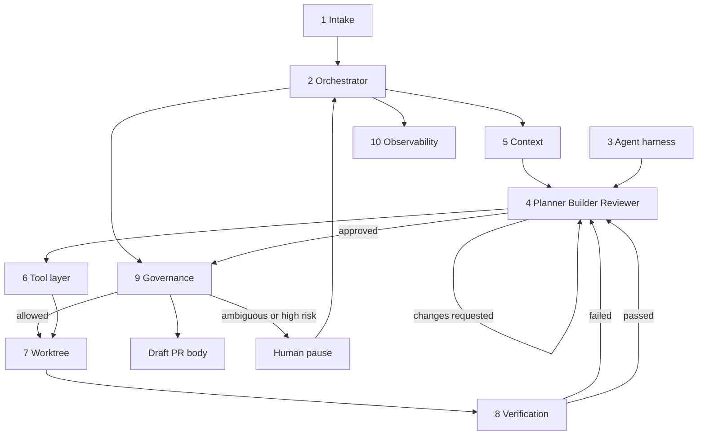

# Decora software factory

A feature request goes in. A draft pull request comes out, or the job pauses when a human has to decide.

The factory builds Decora, the interior-design agent in the `decor-agent` checkout. It does not furnish rooms. It does not merge. It analyzes the repo, plans the change, implements it in an isolated git worktree, runs a deterministic gate, reviews the diff it actually produced, and writes a draft pull request for a person.

The demo runs offline. `OPENAI_API_KEY` is read from the environment when you opt into the OpenAI harness. That account has no quota, so the default harness is a mock with the same structured outputs.

```bash
make demo
```

## Architecture



The stage machine is a graph. Verification and review both send work back to the builder. Ambiguity stops for a human instead of guessing.

```mermaid
stateDiagram-v2
  [*] --> Intake
  Intake --> Context
  Context --> Plan
  Plan --> GovernPlan
  GovernPlan --> AwaitHuman: ambiguous or high risk
  GovernPlan --> Build: inside policy
  AwaitHuman --> Plan: clarified
  AwaitHuman --> Build: approved
  Build --> Verify
  Verify --> Build: tests or flag audit failed
  Verify --> Review: passed
  Review --> Build: changes requested
  Review --> GovernShip: approved
  GovernShip --> Build: flag missing or default on
  GovernShip --> DraftPR: policy passes
  DraftPR --> Done
  Verify --> Failed: retries exhausted
```



| # | Component | Where | What it does |
| --- | --- | --- | --- |
| 1 | Intake | `factory/intake/` | JSON spec or a GitHub issue body |
| 2 | Orchestrator | `factory/orchestrator/` | Python state machine, SQLite job state, retries, timeouts |
| 3 | Agent harness | `factory/harness/` | Mock offline, or OpenAI Agents SDK structured outputs |
| 4 | Specialist agents | `factory/agents/` | Planner, Builder, Reviewer |
| 5 | Context | `factory/context/` | Read-only repo scan. Skips `app/pim/` |
| 6 | Tool layer | `factory/tools/` | Allowlisted commands and path-checked edits |
| 7 | Execution | `factory/execution/` | Git worktree outside the primary checkout |
| 8 | Verification | `factory/verification/` | pytest, ruff, mypy, syntax compile, flag audit |
| 9 | Governance | `factory/governance/`, `policy.yaml` | Permissions and human-approval pauses |
| 10 | Observability | `factory/observability/` | JSON logs, OpenTelemetry-ready spans, run summary |

Agents return structured data. The orchestrator decides the next stage. The tool layer is what actually writes files and runs commands. A later Temporal workflow can call the same handlers as activities; the handlers do not own the control flow.

## Demo

From this directory:

```bash
make demo
```

That command:

1. Loads `samples/decor-room-mood.json`.
2. Creates a git worktree of Decora. The primary checkout is not edited.
3. Plans a dark capability: `GET /api/capabilities` gains `room_mood` only when LaunchDarkly flag `decor-room-mood` is on. The code default is off.
4. The sample asks the first build to leave `FLAG_DEFAULT = True`. Pytest and the flag audit fail. The builder reads that output and commits the default off.
5. The reviewer reads `git diff`, the verification log, and the acceptance lines. It does not trust the builder's summary.
6. Writes a draft pull request body under `.factory/runs/<job-id>/` and deletes the worktree and the `factory/job-*` branch.

Nothing is pushed. `policy.yaml` has `pull_request.allow_push: false`. The CLI also refuses `--push` when the target is the Decora checkout.

Other entry points:

```bash
make test
python -m factory run samples/decor-room-mood.json --repo /path/to/decor-agent
python -m factory run samples/ambiguous.json --repo /path/to/decor-agent
python -m factory resume <job-id> --answer "flag decor-room-mood on capabilities, default off"
python -m factory status <job-id>
python -m factory issue --slug owner/name --number 12
```

`samples/ambiguous.json` stops before any code is written and asks for acceptance checks and a flag key.

Artifacts for a run:

- `implementation_plan.json`
- `review_report.json`
- `verify-1.diff` (the failing build) and `diff.patch` (what would ship)
- `pr-body.md`
- `summary.json` with duration, token counts, and retries
- `log.jsonl` and `trace.jsonl`

## LaunchDarkly

Every new user-facing behavior in this factory is wrapped in a flag whose code default is off. The verifier and the ship gate both read the diff. A builder summary that claims the flag exists is not evidence. The reviewer runs the same check on the diff.

This demo does not create the flag in a live LaunchDarkly project. Turning it on is a human action after review.

## Policy

`policy.yaml` is the approval boundary:

- Allowlisted commands: pytest, ruff, mypy, python, git status/diff/add/commit/log/show/rev-parse
- Denied: push, reset, rebase, `--no-verify`, secret paths, `app/pim/**`
- Auto-approve only `low` risk plans
- Pause on an ambiguous plan or a `high` risk plan
- Pull requests stay drafts

The execution environment may create and delete `factory/job-*` worktrees. The agent tool layer cannot.

## Tests

```bash
make test
```

Orchestrator tests cover the verify loop, exhausted retries, human pause and resume, SQLite reload, review rejection, timeouts, a denied push, a missing flag, and the room-mood worktree path.

## What is stubbed

- **OpenAI Agents SDK.** `factory/harness/openai_agents.py` calls the SDK with structured outputs for Planner, Builder, and Reviewer. The demo uses `MockHarness` so the pipeline runs without quota. Install the extra and pass `--agents openai` when a key with quota is available. The reviewer still runs the deterministic diff audit; model prose cannot flip a failed check to passing.
- **Temporal.** The state machine and SQLite job row are the swap point. Temporal is not running.
- **GitHub publish.** `gh pr create --draft` is implemented and untested against a real remote. Policy keeps it off. The demo writes the body locally.
- **Live flag creation.** The safety check is the diff. This process does not call LaunchDarkly to create or toggle a flag.
- **Mock recipes.** Offline mode implements one change: `decor-room-mood` on `/api/capabilities`. Any other request pauses for a human.
- **Docker.** `docker compose up --build` runs the factory test suite. It does not run the Decora demo.

## Layout

```
policy.yaml                 governance
samples/                    feature requests
factory/intake/             1
factory/orchestrator/       2
factory/harness/            3
factory/agents/             4
factory/context/            5
factory/tools/              6
factory/execution/          7
factory/verification/       8
factory/governance/         9
factory/observability/      10
```
